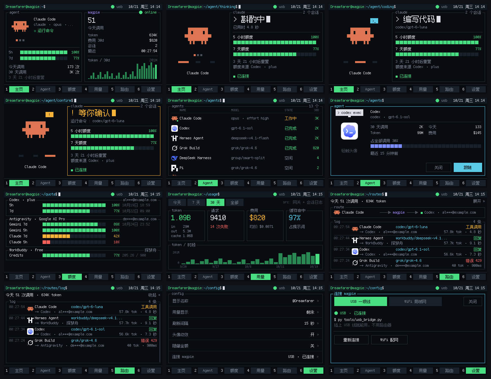
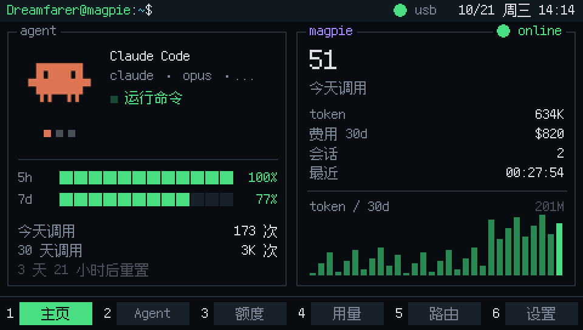
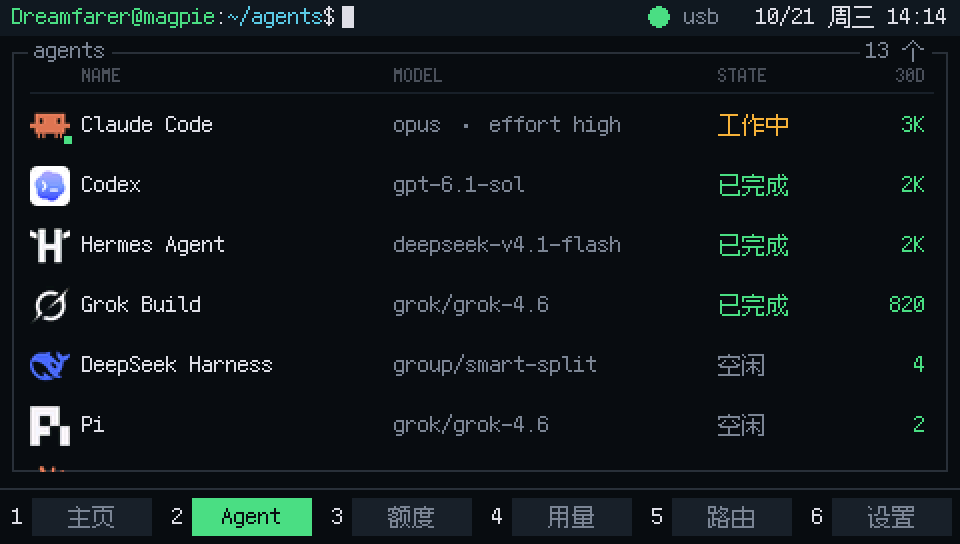
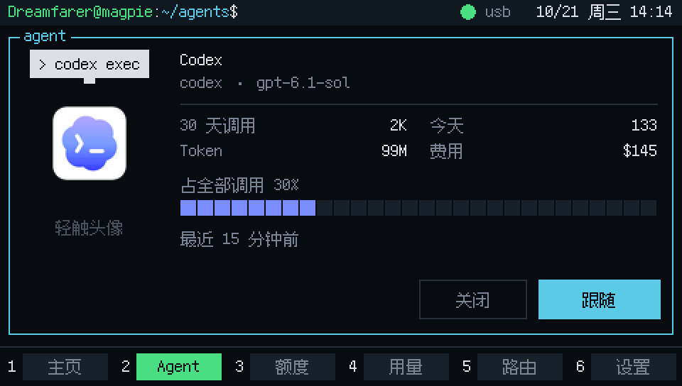
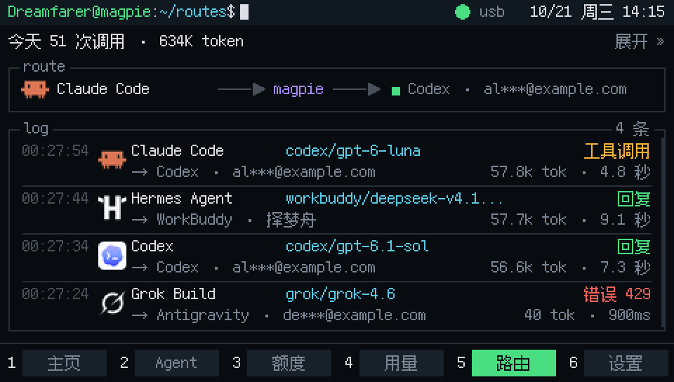

<div align="center">

# magpie-dash

**面向 magpie LLM 网关的终端风格 480×272 触摸仪表盘。**
ESP32-S3 · LVGL 8 · 一根 USB 线或普通 WiFi

*哪个 agent 正在工作中、剩余多少额度、今日开销几何——一眼即知，无需打开浏览器标签页。*

[](https://github.com/dreamfarer-space/magpie-dash/actions/workflows/ci.yml)
[](LICENSE)
[](https://www.espressif.com/en/products/socs/esp32-s3)
[](https://lvgl.io)
[](https://github.com/TakWolf/ark-pixel-font)

[English](README.md) · **简体中文**

</div>

## 功能特性

<p align="center">
  
</p>
<p align="center"><a href="docs/demo.mp4">高清 MP4</a>：在实体板上渲染的逐帧捕获（演示数据），记录每一次触控。</p>

终端风格：顶部一行是 shell 提示符（`user@magpie:~/agents$`、闪烁光标、链路状态、时间）。底部一行提供 htop 风格的功能键（`1 Home` ... `6 Settings`）。中间是带有标题的线框窗格。字体使用 **Ark Pixel 等宽**（半角单元格 6 px，全角单元格 12 px）。所有列均对齐到这一跨行、跨页的 80 列网格上。颜色代表状态：绿色 = 正常 / 剩余额度，琥珀色 = 繁忙 / 额度较低，红色 = 错误 / 额度耗尽，外加各个 agent 的品牌色。



| 页面 | 内容 |
|---|---|
| **Home** | 左侧：活跃 agent（头像、模型、状态、双额度进度条、今日 / 30 天调用次数、重置倒计时）。右侧：今日调用次数与 token、选定用量周期（默认为 30 天）的花费与 token 图表，以及所获取请求记录中不同会话的数量。 |
| **Status 状态页 ×3** | 思考中 / 编写代码 / 等待确认：最新请求的延迟、模型与额度消耗；通过头像下方的三个小横条互相切换。 |
| **Agent** | magpie 管理的全部 agent：名称、模型、状态（工作中 / 已完成 / 空闲 / 未使用）、30 天调用次数。点击某一行可查看详情或开启「跟随」。 |
| **`额度`** | 每个上游账号一个窗格。每个额度窗口显示一条 `■` 进度条、百分比与重置时间。 |
| **`用量`** | 今日 / 7 天 / 30 天 / 全部：token（输入 / 输出 / 缓存）、请求数与失败数、花费与平均价格、缓存命中率、分时段柱状图。 |
| **Routes** | 最新请求的拓扑结构（`agent ──▶ magpie ──▶ upstream account`），下方是可滚动的请求日志。点击顶部栏可展开为全页日志。 |
| **Settings** | 显示名称（屏幕键盘）、剩余 / 已用额度切换、刷新间隔、头像动效、隐藏开销切换、连接模式（USB / WiFi）。 |

| | | |
|---|---|---|
|  |  |  |
|  |  |  |

### 交互

- 底部功能键在**手指按下的瞬间**即切换页面，而非等待抬起。从按下到整页渲染完成的延迟为 51 ms（板载实测，见下文）。
- 点击 Home 左侧窗格打开 Status 状态页；点击右侧窗格打开 Agent 列表。点击 shell 提示符（显示您的名称）打开 Settings。
- 点击头像：精灵图标会跳动并显示其专属台词（例如 Claude Code 的「Clauding...」、Codex 的「> codex exec」）；连续点击 5 次会触发抱怨。
- Agent 详情中的「跟随」会将 Home 和 Status 页面固定到该 agent，10 分钟后自动恢复为「跟随最新请求」。
- 长按顶部提示符栏进入两点触摸校准。

## 硬件

| 项目 | 规格 |
|---|---|
| 开发板 | Guition **JC4827W543** (4.3" 480×272 IPS) |
| SoC | ESP32-S3-WROOM-1 N4R8: 4 MB flash, 8 MB PSRAM |
| 屏幕 | NV3041A, QSPI: CS45 / SCK47 / D0-21 / D1-48 / D2-40 / D3-39, backlight GPIO1, TE GPIO0 |
| 触摸 | GT911, I²C: SCL4 / SDA8 / INT3 / RST38, address 0x5D |
| 调试 | 板载 USB-Serial/JTAG（无 CH340），`CDCOnBoot=cdc`, 921600 baud |

> GPIO0 连接的是 LCD TE 信号，**不是物理按键**。该开发板没有可用的 BOOT 键；页面导航完全依赖触摸。

## 快速开始

工具链（与 [`.github/workflows/ci.yml`](.github/workflows/ci.yml) 中的 CI 一致）：arduino-cli、esp32 core **3.3.12**、lvgl **8.3.7**、ArduinoJson **7.4.3**、GFX Library for Arduino **1.6.9**。将 [`firmware/lv_conf.h`](firmware/lv_conf.h) 放置在 Arduino 的 `libraries/` 目录下，与 `lvgl/` 同级。

```bash
bash flash.sh            # Compile only
bash flash.sh flash      # Compile + flash + capture 10 seconds of serial logs
```

`flash.sh` 顶部定义了本机 arduino-cli 与数据目录的路径；迁移到其他机器时修改这几行即可。在烧录过程中，脚本会先停止自动启动的 USB 桥接任务，并在烧录完成后将其重新启动。

## 连接 magpie

### USB 线（默认）

将开发板插入电脑。USB 同时供电并传输数据。无需 WiFi 亦无需开放网络端口；电脑继续使用其现有的网络配置。在宿主机上运行桥接程序（仅在 127.0.0.1 读取 magpie）：

```bash
py -3.11 tools/usb_bridge.py --port COM9                       # Run in foreground
powershell -File tools/bridge_autostart.ps1 -Action install    # run at Windows logon (pythonw, no console; installing does not start it)
powershell -File tools/bridge_autostart.ps1 -Action status
```

- 通过 VID/PID `0x303a:0x1001` 自动识别开发板，即使 COM 端口发生变动也能重新连接。通过命名互斥量（named mutex）阻止多开实例。
- 状态写入 `build_logs/usb_bridge_status.json`；日志写入 `build_logs/usb_bridge.log`。
- 协议采用包含长度前缀与 CRC32 的帧结构（`!MG1 <H|R|C> <seq> <len> <crc>\n` + 数据体）。请求白名单仅放行只读的仪表盘端点。在 USB 握手激活期间，帧结构之外的字节将被直接丢弃，因此串口底噪绝不会误触发调试动作。当链路未激活时，固件回退为原始的单按键串口命令。

### WiFi（当前构建未接入）

连接面板中提供了 WiFi 选项，且网络相关代码均已编译进固件，但默认构建在 `firmware/magepie_dash/config.h` 中启用了 `USB_LINK_ONLY 1`，从而在 `setup()`/`loop()` 中跳过了 `netcfg_begin()` / `netcfg_loop()`。因此若在面板中切换到 WiFi，虽然会拉起热点，但既不会提供配网页面也不会推进 Station 连网状态，所以**目前请仅使用 USB 连接**。以下说明仅作为日后移除该防护并在硬件上验证 WiFi 路径时的参考。

启用后的工作方式：开发板加入 2.4 GHz 网络，并通过 HTTP 与运行 magpie 的机器通信。首次配网在设备端完成：开启名为 `magpie-dash-setup`（密码 `magpie123`）的无线热点，访问 `http://192.168.4.1`，分别输入 SSID、密码、网关地址与端口。

两项限制：

1. **magpie 仅监听 127.0.0.1。** 需在宿主机上运行转发程序（`python tools/gw_relay.py 3426 127.0.0.1 3425`），然后在网关字段输入电脑的 IP，在端口字段输入 `3426`。
2. **ESP32-S3 仅支持 2.4 GHz，且本固件未实现 802.1X 企业级认证。** 校园网等认证网络无法直接使用；请使用手机热点或普通路由器（`tools/start_hotspot.ps1` 可启动 Windows 热点）。

入网过程为非阻塞式，且配置持久化存储在 NVS 中，因此重新烧录固件也不会丢失配置。

## 数据来源

| 请求 | 用到的字段 |
|---|---|
| `/v1/magpie/quotas` | `provider/name/plan/user`, `windows[].name/used/remaining/resetsAt` |
| `/v1/magpie/usage?period=` | `calls/errors/input/output/cache_read/cost`, `series[]` |
| `/v1/magpie/usage/requests?period=&limit=12` | `rows[]` (agent / provider / model / stop / token / duration / status), `total` |
| `/dash/agents`（由桥接 / relay 本地提供） | Agent 列表：`id/name/model/calls/tokens/cost/today/last` |

- magpie 的 `period` 参数仅接受 `today/7d/30d/all`（传入 `1d` 会静默回退为 `30d`）。在 `用量` 页面所选的时间周期会同时作用于 `/usage` 和 `/usage/requests`。
- magpie 没有用于列出 agent 的公开端点。`/dash/agents` 由桥接程序在本地组装：来自 `~/.config/magpie/library.json` 的 `applied` + 来自 `applied.json` 的模型 + 30 天每日 `by.agent` 指标 + 最新请求的时间戳。
- 会话级状态（「Thinking / Writing code / Awaiting confirmation」）并未由 API 暴露。这三个状态页面是由人工手动切换的视图，而非自动检测到的状态；页面上的请求详情来自当前所关注 agent 的最新一次调用。
- 头像采用真实的 agent logo（LobeHub 图标集，`tools/agent_logos/*.svg`）。`tools/gen_agents.py` 会将它们预渲染为 20、56 和 88 px 并写入 `agent_sprites.h`，以实现在屏幕上 1:1 像素呈现。各 logo 的版权归其各自所有者所有。

## 延迟

所有数据均通过串口命令（`P`、`p`、`q`、`l`）在开发板上实测得出，绝非估算。

### 亚秒级换页

换页操作（触摸按下到整页渲染完成），通过串口命令 `P` 经由 LVGL 输入驱动模拟功能键按下进行触发：

| 指标 | 旧版 UI | 当前 UI |
|---|---|---|
| 按下到整页渲染完成 | 抬起后 46 ms（加上真实手指按压停留，约为 150 ms） | **平均 51 ms / 最差 57 ms**，与按压停留时间无关 |
| 换页时的重绘区域 | 480×272 完整屏幕 | 480×226 页面区域条带 + 两个功能键单元格 |

优化措施：

- **按下即触发换页**：物理点击在抬起前通常会停留 80–150 ms。旧版 UI 会等待抬起后再开始渲染。由于功能键栏无需滚动，按下必定构成一次点击，因此可以立即触发渲染。
- **仅重绘中间条带**：提示符栏与功能键栏为全局常驻，在换页时保持不变。页面区域本身的尺寸仅为 480×226。
- **消除昂贵的绘制开销**：移除了 `额度` 进度弧线与缩放位图。将原本由 110 个点组成的折线分隔线（每段都需要进行带遮罩的线段绘制）替换为单个 1 px 的矩形。使用单个 `■` 标签渲染进度条，而非 20 个独立对象。当坐标未发生变化时，呼吸动效不再反复触发无效化重绘。
- **快速连击合并**：距上次重绘超过 150 ms 的换页请求会立即渲染；落在该时间窗口内的请求则会合并为最新的目标，并在最后一次请求的 20 ms 后统一绘制一次。因此，从空闲状态开始执行串口 `b` 时会产生两次绘制。
- **交互期间推迟数据刷新**：当手指接触屏幕时，数据重绘将被推迟，最长推迟 3 秒。

底层显示与触摸调优记录：

| 版本 | 全屏重绘耗时 | 刷新耗时 (QSPI) |
|---|---|---|
| 480×20 双缓冲，内部 RAM | 134–157 ms | 41 ms |
| 全屏缓冲区置于 PSRAM | 71–78 ms | 40 ms |
| + QSPI 40 MHz（80 MHz APB 精确二分频；请求 32 MHz 实际仅得 ~20 MHz） | 62–71 ms | 32 ms |
| + 72 行 × 2 内部 DMA RAM 双缓冲 + 异步刷新任务（渲染第 N+1 条带时传输第 N 条带） | 34–40 ms | 与渲染重叠 |

- 条带数量比缓冲区所在的内存位置更重要：480×20 的缓冲区会迫使 LVGL 每次重绘时遍历对象树 14 次。
- LVGL 堆内存置于 PSRAM 中（对象树过大，无法放入内部 RAM），从而将内部堆内存预留给 WiFi 驱动。
- 触摸轮询与 LVGL 解耦：GT911 在 `display_tick()` 中采样，最多每 12 ms 采样一次。LVGL 读取回调仅消费锁存的按下/抬起边沿，绝不直接访问 I²C；显示刷新任务完全不轮询触摸。正是这种锁存机制确保了全屏重绘期间点击不会丢失。
- `LV_DISP_DEF_REFR_PERIOD` 与 `LV_INDEV_DEF_READ_PERIOD` 均设置为 15 ms（默认值为 30 ms）。

### 非阻塞串口日志

当宿主机停止读取串口时（桥接程序终止或 USB 挂起），CDC 发送环形缓冲区会被填满。默认情况下，`Serial.printf` 会阻塞调用它的任务，导致取数任务与主循环一并锁死。

固件通过调用 `Serial.setTxTimeoutMs(0)` 实现丢弃数据帧而非阻塞。周期性日志会预先检查 `availableForWrite()`。逐事件日志默认关闭（可通过串口 `V` 开启）。

回归测试：`tools/test_usb_disconnect.py` 会断开串口 100 秒；重新连接后开发板立即可恢复通信。

## 串口指令

当 USB 桥接运行时，原始串口字节会被直接丢弃。指令必须以 `C` 帧格式发送（`usb_bridge.py --command`、`board_shot.py --cmd`）。`@x,y` 帧用于模拟坐标 `(x, y)` 处的物理点击。

| 按键 | 动作 |
|---|---|
| `0`..`9` | 切换到第 N 页 |
| `m` / `r` | 加载演示数据 / 返回实时数据并立即刷新 |
| `s` / `S` | 截取全部 10 页 / 仅截取当前屏幕（保留遮罩层与弹窗） |
| `P` | 测量换页延迟：进行 12 次测试测量从按下到屏幕渲染完成的时间，并报告平均值与最差情况 |
| `p` / `l` / `q` | 各页面全屏重绘耗时（拆分为 flush / render）/ 各页面空闲重绘开销 / 主循环与刷新计时（每 2 秒） |
| `A` / `Z` / `B` | 回归测试：命中测试（66 项检查）/ Settings 页面（6 项检查）/ Agent 详情（6 项检查），均经由 LVGL 输入驱动派发 |
| `b` | 连续快速点击 4 次（验证点击合并） |
| `f` / `k` / `o` | 切换到下一个 agent 头像 / 点击当前头像 / 打开首行详情面板 |
| `F` / `L` `X` / `y` `Y` | 循环切换 `用量` 周期 / 打开、关闭连接面板 / 打开、关闭键盘 |
| `G` / `H` | 向上 / 向下滚动路由日志 |
| `T` / `c` `x` / `K` | 颜色与触摸方向测试图样 / 打开、关闭校准画面 / 清除 NVS 中的触摸校准数据 |
| `t` / `d` / `V` / `D` | 原始触摸坐标 / 导出对象树 / 切换逐事件日志开关 / 将设置恢复为默认值 |

`A`、`Z` 与 `B` 直接验证 LVGL 的点击命中检测与导航逻辑，无需查询 GT911。物理触摸表现必须在硬件实物上进行验证。

## 颜色与触摸方向

- 显示颜色采用驱动默认的 `MADCTL = 0xC0` (MX|MY|RGB)。若红蓝颜色出现对调，在修改素材之前，可发送串口 `T` 检查四个色块，以确认面板通道顺序、字节序或颜色反转。
- 触摸坐标为 1:1 映射（`ax=1 bx=0 ay=1 by=0`）。此前保存在 NVS 中的倒置校准数据曾导致所有坐标轴镜像反转，表现为点击无响应。发送串口 `K` 即可清除已保存的校准数据。

## 仓库目录结构

```
firmware/magepie_dash/   Arduino project (ui.cpp: UI, gateway.cpp: data polling, usb_link.cpp: protocol, display_port.cpp: display and touch)
firmware/lv_conf.h       LVGL configuration; copy to Arduino libraries/ directory
tools/                   USB bridge, relay, font/sprite generators, screenshot/recording tools, regression tests
docs/                    Screenshots and demo assets for README
.github/                 CI workflows, PR templates, dependabot configuration
```

## 开发

```bash
python tools/gen_fonts.py          # Rebuild font subsets (Ark Pixel monospace 10/12/24, 1bpp)
python tools/check_glyphs.py       # Verify all UI string glyphs exist in the font subsets (runs in CI)
python tools/gen_agents.py --write  # agent logos -> agent_sprites.h (needs resvg-py, pillow)
# (tools/extract_sprites.py needs real/pages/page*.png, which are not in the repo)
```

- 字体子集直接从固件源码中的字符串字面量中提取。添加 UI 文案后需重新运行 `gen_fonts.py`。来自网关的动态字符串（例如账号名称）必须列入其 `STRINGS` 数组中。Ark Pixel 12 px 中缺失的字符（例如「即」、「热」）会导致 `check_glyphs.py` 报错失败，必须换用其他词汇表达。
- CI（在每次 PR 时运行）：使用上述完全相同的工具链构建固件，并将生成的 `.bin` 作为构件（artifact）上传。同时运行工具脚本编译检查、USB 协议单元测试以及字形验证。`master` 分支受保护：提交变更必须通过 Pull Request、通过 CI 检查，且分支必须为最新。详见 [CONTRIBUTING.md](CONTRIBUTING.md)。

### 屏幕截图

截取屏幕截图前需停止 USB 桥接程序以释放串口。在占用串口连接期间，`tools/board_shot.py` 会代表桥接程序应答数据查询，从而保持链路处于活跃状态：

```bash
py -3.11 tools/board_shot.py --demo --all --out shots          # Capture all 10 pages using demo data
py -3.11 tools/board_shot.py --cmd 4 --cmd o --shot --out shots # Open Agent details sheet, then capture current screen
py -3.11 tools/board_shot.py --tap 120,258 --shot --out shots   # Simulate physical tap, then capture screen
py -3.11 tools/demo_reel.py capture && py -3.11 tools/demo_reel.py render   # Re-record demo assets for README
```

数据帧按行条带传输，附带偏移量与校验和（`OOOOO:<hex>*SS`）。若行数据丢失或损坏，工具会重新转储整个当前屏幕（最多尝试四轮），并合并通过校验的条带；仍有缺失的行将被报告为捕获未完成。

## License

[MIT](LICENSE)。各个 agent 的 logo 版权归其各自所有者所有。Ark Pixel 字体遵循 SIL OFL 1.1 许可协议。